<div align="center">

# Trance Engine

**A music video directed by the music.**

Thirty-three generative scenes, each a small program sealed inside its own [Psychoscript](https://psychoscript.com/) VM,
cut together on the beat by a director that has read the whole song first.

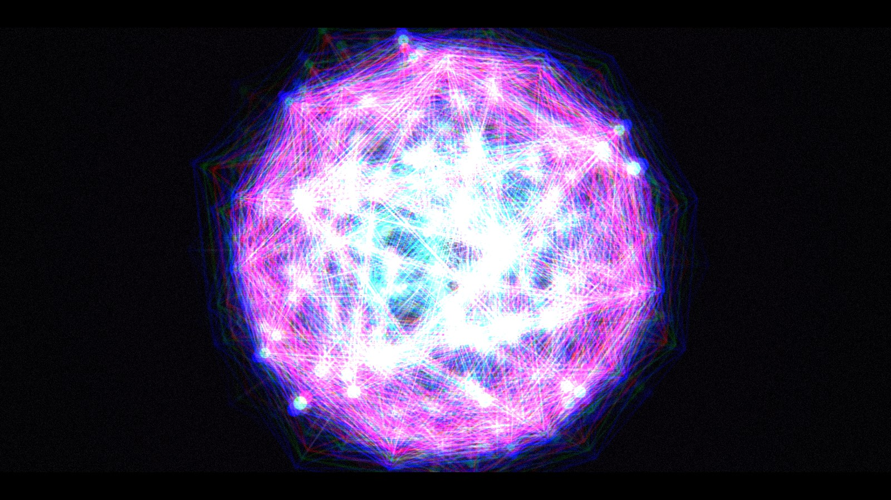

</div>

---

Drop in a song and Trance Engine maps it (tempo, bars, kicks, snares, hats, builds, breakdowns and drops), plans a
whole edit around that structure, and then performs it live. Cuts land on downbeats, builds accelerate into the
drop, the drop smash-cuts to a scene's climax, and breakdowns dissolve slowly. Drag the timeline and the picture
rewinds with the song: every scene is restored from a snapshot of its VM taken the first time through.

It is one HTML file. No server, no build step for viewers, and nothing is uploaded: songs are decoded and mapped
on your own machine.

<div align="center">
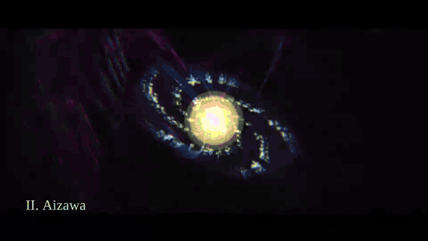
<br><sub><i>Breakneck, 0:18 → 0:25: one-bar flourish inserts through the build, the starling flock packing into an orb, the drop, and the flock spelling SLOP.</i></sub>
</div>

## Highlights

- **Planned, not reactive.** A song mapper (beat tracking by dynamic programming, onset detection per drum type,
  bar-level novelty segmentation, drop detection) feeds a director that plans every shot before the first frame.
  Builds go 4 bars → 2 → 1 → 1, the last beat repeats as a VM beat-repeat, and the drop lands within a frame.
- **Scrub the timeline, rewind the scenes.** Psychoscript can suspend a running program to bytes and resume it
  later. The player keyframes every shot as it plays; seeking restores the nearest snapshot and runs the VM ahead
  at full speed to the exact moment.
- **Every sound has its own job.** Kicks punch and pump, snares slice and shake, hats sparkle, pitch tints, builds
  push in and close the letterbox, drops throw it open with a flash and a shockwave.
- **Scenes are sandboxed programs.** A scene's only way out of its VM is `frame(shapes, fx)`. You can edit any
  scene live in the built-in editor; a broken one cannot take the page down.
- **Psychoscript-only tricks.** Beat-repeat stutters rewind a scene one beat. Forks clone a running scene into a
  second VM mid-flight. Scene memory parks a scene and resumes it, built-up state intact, minutes later.
- **Works offline.** `bun run build:offline` produces one 11 MB file with the songs inside. It also installs as a
  desktop app from the Claude desktop app.

## The scenes

Nine **feature** scenes tell the story in four phases each (the director picks the phase from the song's
structure); twenty-four **flourishes** punctuate it as one-bar inserts and transitions.

| | | |
|:-:|:-:|:-:|
| 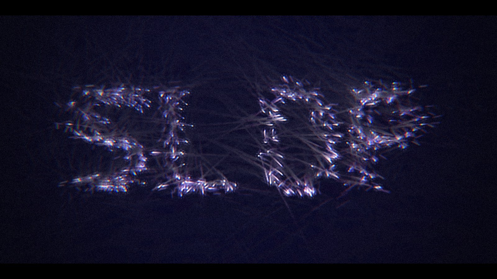 | 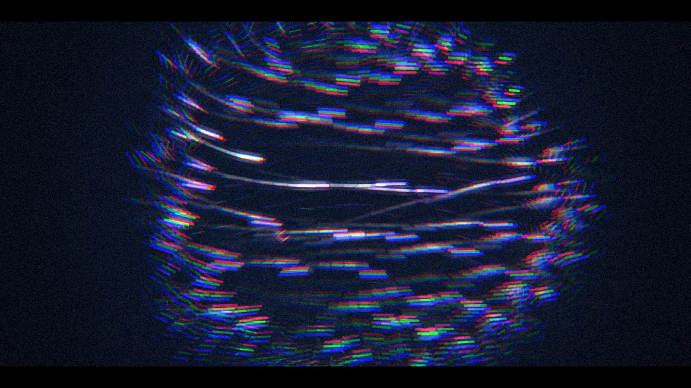 | 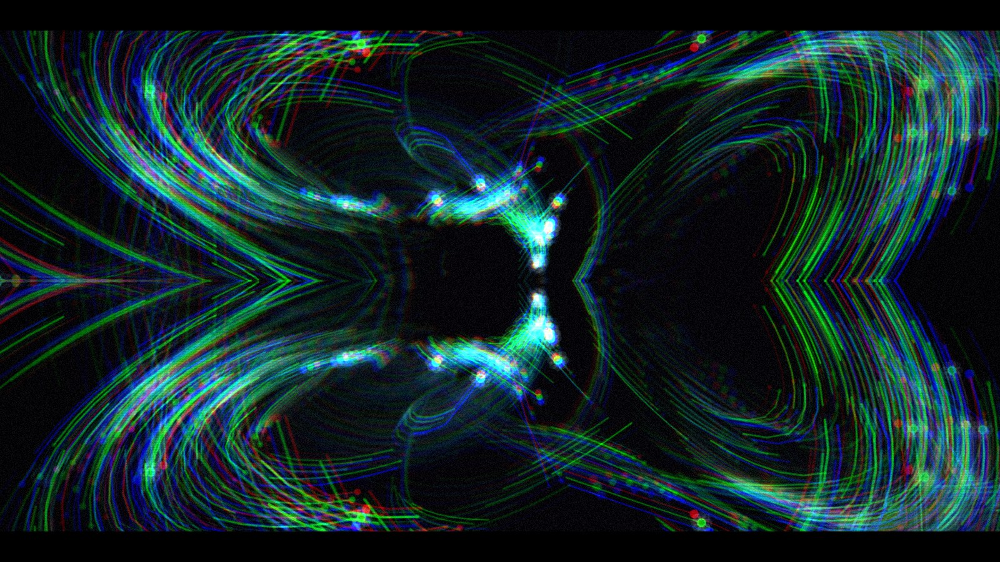 |
| **Murmuration** · a 3D starling flock that pours itself into shapes, gathers into an orb through a build, bursts on the drop and spells words | *Gathering* · the orb tightens and spins faster as the drop approaches; a countdown ring closes in | **Strange attractor** · Thomas, Aizawa, Lorenz and Halvorsen systems; the bass pushes Thomas past its chaos threshold |
| 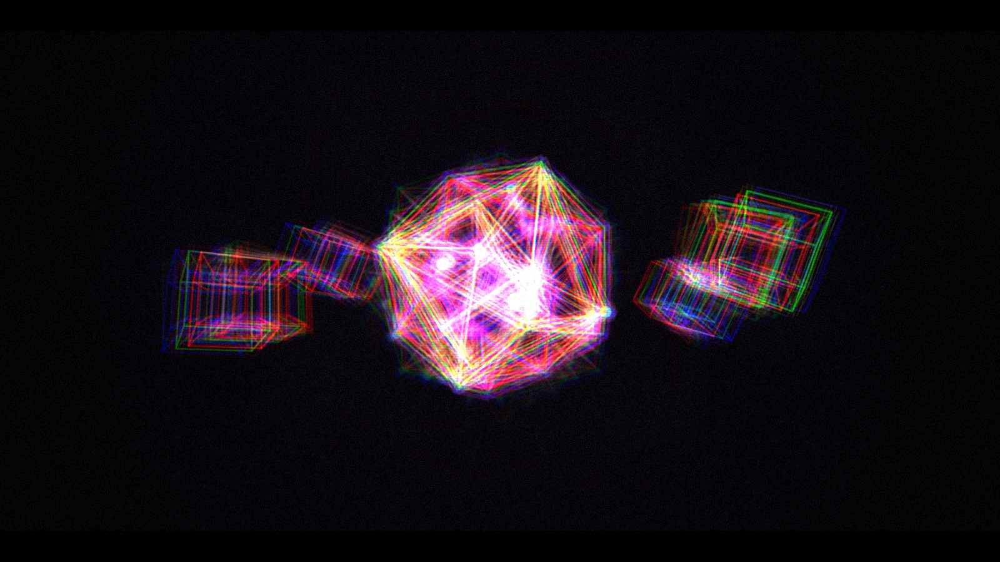 | 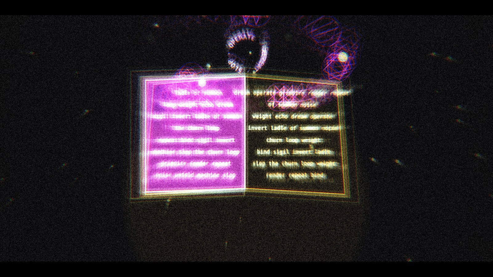 | 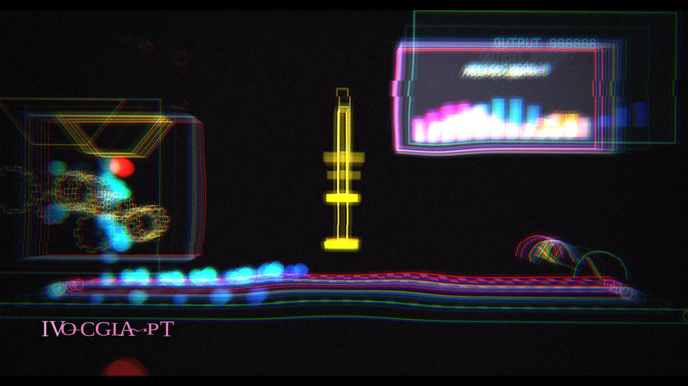 |
| **Polytope chapel** · 4D solids rotating through 4D; every beat turns an eighth, every snare flips a quarter | **The Grimoire** · a spellbook that opens, writes itself and summons | **The Sloperator** · a machine that boots, produces slop on the beat, overclocks and melts down |
| 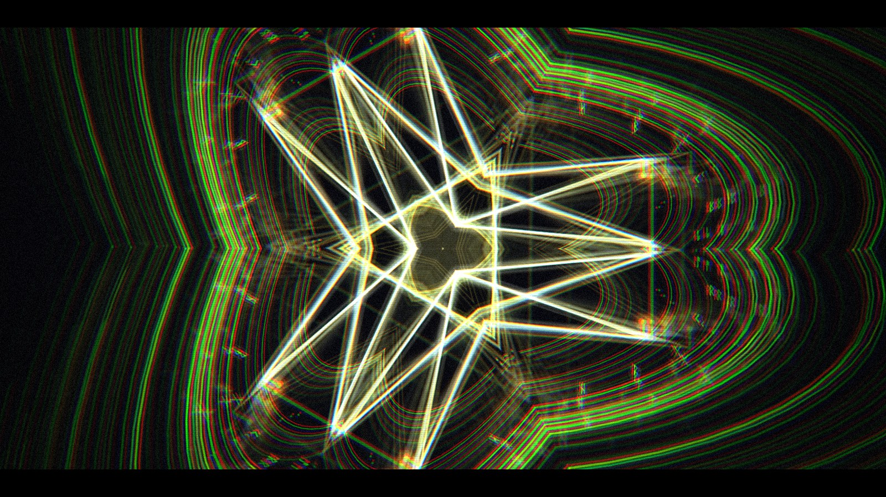 | 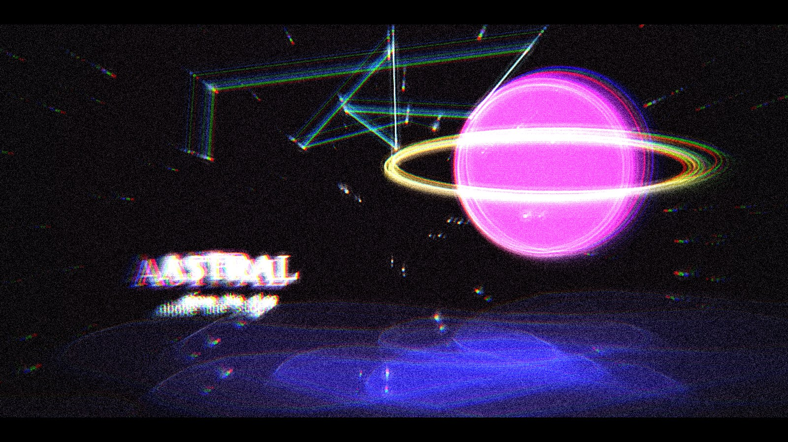 | 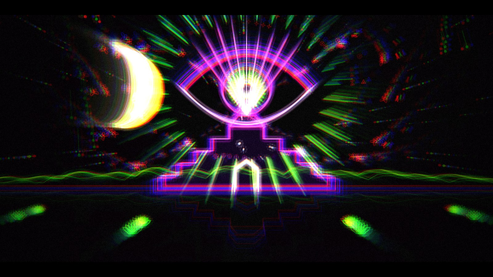 |
| **Summoning circle** | **Astral city** | **Eclipse temple** |

<details>
<summary>All 33 scenes</summary>

| Scene | Tier | Phases |
|---|---|---|
| The Grimoire | feature | I. The book · II. The writing · III. The sigils · IV. The opening |
| The Sloperator | feature | I. Boot · II. Production · III. Overclock · IV. Meltdown |
| Summoning circle | feature | I. Chalk · II. Ignition · III. The presence · IV. Overflow |
| Astral city | feature | I. Dusk drive · II. Neon district · III. Liftoff · IV. Astral |
| Eclipse temple | feature | I. Dawn · II. Procession · III. Ascension · IV. Eclipse |
| Spectral manifold | feature | I. Spectral sphere · II. Bass torus · III. Trefoil knot · IV. Bloom |
| Murmuration | feature | I. Dusk · II. Murmuration · III. Gathering · IV. Scatter |
| Strange attractor | feature | I. Thomas · II. Aizawa · III. Lorenz · IV. Halvorsen |
| Polytope chapel | feature | I. Tesseract · II. Compound · III. Cathedral · IV. 600-cell |
| Kinetic type, Synthwave horizon, Solar mandala, Aurora ribbons, Neon ocean, Starfield warp, Beat fireworks, Unzipping helix, Firefly swarm, Sacred geometry, Spiral galaxy, Polygon tunnel, Glyph rain, Moiré rings, Lightning storm, Spectrum halo, Crystal shards, Neon vines, Spectrum terrain, Melting grid, Orbit garden, Lava lamp, Lissajous bloom, Hypno spiral | flourish | one |

Several flourishes were designed by a swarm of Claude Haiku agents working from [the scene brief](docs/scene-api.md);
the features were written by Claude.

</details>

## The player

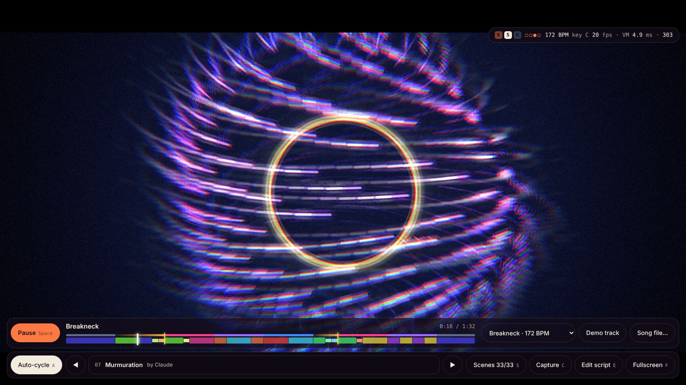

The strip above the seek bar is the planned edit: the thin top lane shows the song's sections (intro, verse,
build, **drop**, main, breakdown, outro), the lower lane every shot coloured by scene, yellow marks the drops.
Drag anywhere on it, even while paused.

| Key | Action |
|---|---|
| <kbd>Space</kbd> | play / pause |
| <kbd>←</kbd> <kbd>→</kbd> or <kbd>P</kbd> <kbd>N</kbd> | previous / next scene |
| <kbd>1</kbd>–<kbd>9</kbd> | jump to a scene |
| <kbd>A</kbd> | auto-cycle (the director) on / off |
| <kbd>S</kbd> | scene list: reorder the rotation, switch scenes on and off |
| <kbd>E</kbd> | edit the current scene's script live (<kbd>Ctrl</kbd>/<kbd>⌘</kbd> + <kbd>Enter</kbd> runs it) |
| <kbd>C</kbd> | capture a moment (a VM snapshot you can jump back to) |
| <kbd>F</kbd> | fullscreen |

Three tracks ship with it: **Grimoire of the Sloperator** (101 BPM, dense and loud: its choruses are found as
lifts in brightness, not loudness), **Slow Burn** (84 BPM half-time with a long breakdown) and **Breakneck**
(172 BPM drum & bass with long builds). The last two were synthesized with known structure so the mapper could
be measured against ground truth. Or drop in any audio file.

## Quick start

```sh
git clone https://github.com/mojomast/tranceengine && cd tranceengine
bun install                 # or: npm install --ignore-scripts
bun run build               # → dist/index.html (+ the songs)
npx serve dist              # any static server; then open the URL it prints
```

To run it from disk with no server, `bun run build:offline` writes `dist/trance-engine-offline.html` with the
songs embedded: double-click it. (The plain `index.html` needs a server, because browsers block a page opened
from disk from reading the song files beside it.)

Requirements: [Bun](https://bun.sh) ≥ 1.1 for the build and tools, `ffmpeg` for the mapping tools, Python 3 with
Playwright for the end-to-end tests. Viewers need only a browser with Web Audio and (ideally) WebGL.

## How it works

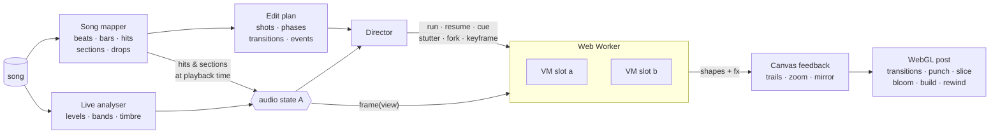

- **[Architecture](docs/architecture.md)**: the modules, the worker protocol, the render pipeline, the snapshot tricks.
- **[Scene API](docs/scene-api.md)**: everything a scene can read and draw, the language subset, budgets, and a template.
- **[Song maps and the director](docs/song-maps-and-director.md)**: how songs are mapped, how the edit is planned, how seeking works.
- **[Testing](docs/testing.md)**: the scene checker, the mapper evaluation, the end-to-end tests, the screenshot tool.

## Contributing

New scenes are the best way in: one file, one manifest line, one command to check it. Start with
[CONTRIBUTING.md](CONTRIBUTING.md). Working with an AI agent? Point it at [AGENTS.md](AGENTS.md).

```sh
cp scenes/solar-mandala.js scenes/my-scene.js     # edit the "// name:" line and go
bun run build && bun tools/check-scene.mjs scenes/my-scene.js
```

## Accessibility

Flashes are rate-limited to two per second (WCAG 2.3.1 allows three). With `prefers-reduced-motion` the engine
drops flashes, stutters, glitches and shake, and softens build effects. The player is fully keyboard-operable.

## Credits

Built by Claude with [@mojomast](https://github.com/mojomast). Scenes run on [Psychoscript](https://psychoscript.com/),
a JavaScript VM whose programs can be suspended to bytes and resumed. The beat tracker follows Ellis (2007),
*Beat Tracking by Dynamic Programming*.
